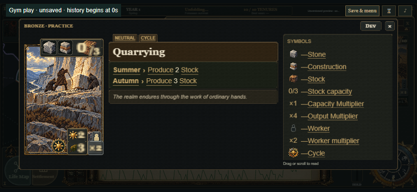
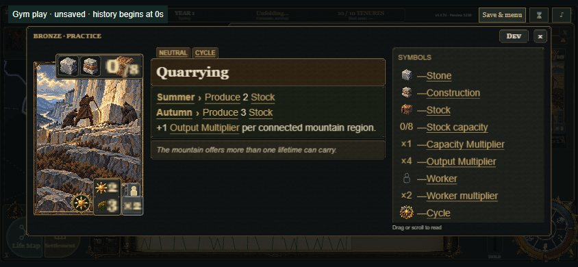

# Ordinary-game card content pass

Implemented for v1.1.74, GameState 52. Covers all 56 shop-obtainable cards and
61 inherited map cards. Legacy and review-only definitions retain their authored
rules. No cards, artwork, unlock tiers, acquisition pools, shop prices or Practice
slots are added. Existing original workbook provenance is retained.

## Direction and rules

- Terrain affinity is printed on individual cards. Biome and Stock traits alone
  grant no bonus. Shared-edge components include their own region and ignore
  ownership and roads. Scaling has no authored cap.
- Starter recipes and their small base capacities remain intact. They receive no
  new self multipliers; purchased support can still benefit matching starters.
- Quarrying: +1 Output per connected mountain region; capacity 8 makes the bonus
  useful before additional storage. Dry Farming: +2 Output on plains in Autumn.
  Logging and Charcoal Burning: +2 Capacity in forest. Foraging: +1 Output in forest.
- Surface Mining and Papermaking: +1 Output with local Tool Stock. Smelting: +1
  Output with Fuel. Toolmaking: +1 Output with Record. Weaponsmithing: +1 Output
  with Tool; its own retained Tool Stock can enable the next activation. Bowmaking:
  +1 Output with Bone. Salt Gathering: +1 Output with Water. These conditions
  inspect retained local Stock without consuming or reserving it.
- Pastoralism: +1 Capacity on plains. Irrigating: +1 Capacity per connected plains
  region. Sheep Husbandry: +1 Capacity with local Water.
- Pattern Carving and Scarred Shields use Synthesis/Trophies for Capacity. Both
  have base yield 2 and base capacity 4 so the first contribution opens useful
  reserve space. Other ordinary keyword cards keep Output scaling. All ten
  ordinary keyword attachments are uncapped. Monster Hunting has base capacity 12.
- Storehouse: +1 Capacity for all local Stock hosts. Granary: +2 Capacity for
  Grain. General and specialised storage are distinct purchases. Open Archive:
  +1 Output for Record while a local Practice holds Paper, alongside its existing
  Record-consuming Influence support. Veterans' Hearth retains Housing and
  supports additional Warrior conversions, differentiating it from Oath Hall.
- Political, Research and Housing cards otherwise keep their existing engines.
  Every scoped card has specific short flavor. Structured readings now expose
  conversion/training targets, before/after-meal timing, Hunt conditions and its
  flat Monster Strength Stock bonus after Output/worker scaling, upkeep
  and support payments, including Public Bakehouse's Fuel condition. Passive
  contributions have separate untimed lines. Implementation notes are removed
  from player-facing rules; provenance remains in the authoring metadata.

## Shared capability and save impact

Practice `stockMultipliers` entries are JSON data: `{kind, amount, biome?,
perRegion?, seasonKeys?, stockedTraitsAny?}`. The implemented kinds are
`outputMultiplier` and `capacity`; the mechanics catalogue registers the
supported parameters. Entries affect only their own host. Conditions combine
with AND; Stock traits and season alternatives use OR. Both pools start at one
and add contributions. Workers, input costs, Research and Charge rules remain
separate. Keyword coefficients use `keywordOutputScale` or
`keywordCapacityScale`, with an optional cap supported for explicitly captured
experiments but omitted on ordinary cards.

No new RNG calls or authoritative mutable fields are introduced. GameState 52
rejects previous saves because removing the global terrain rule changes their
continuation. Captured GameConfig remains schema 31. Forecast and authoritative
replay use the same resolver; no forecast-specific effects are introduced.

## Composition, limits and review

A Common opening can fit Foraging, Logging, Quarrying, Surface Mining and
Observation in five slots. Quarrying earns its mountain bonus without a Tool
provider; later Tool supply improves Mining. Granary and Storehouse use the
separate construction strip. A Bronze Scholar board can fit Foraging, Logging,
Record Keeping, Pattern Carving and Open Lessons; all Pattern Carving ingredients
are obtainable at Bronze, and local Scholar staffing supports Synthesis. Warrior
Scarred Shields needs only Timber, while a real Bronze Campaign can earn the
first persistent Trophy. Existing fixture tests exercise both class openings.

Storage still clips yield. The largest mountain engines need consumers or
additional Storehouses; seasonal harvest builds need reserves; processing
bonuses can disappear when their enabler is spent. Capacity scaling creates
reserves over repeated paid activations rather than free production. Class
bonuses become dormant between matching Vassals. These are intentional
weaknesses. Balance is provisional: inspect actual retained Stock and meals,
not only the multiplier total.

This pass serves engine composition, limited-space purchasing and inspectable
consequences (game-design pillars 1, 2 and 4). Uncapped engines can compound;
long-run balance remains a playtest question. No additional cap is introduced
to hide that question.

## Verification and review recipe

Run `node scripts/card-content-pass-test.mjs`, `npm run test:keywords`,
`npm run test:detailed-settlements` and `npm run verify`. The focused contract
checks all 117 catalogue faces, actual terrain/supply activation and Stock
retention, blocked atomic payment, storage specialisation, pending construction,
captured edited coefficients, pure reads and exact JSON/replay/forecast parity.
The keyword suites exercise class boundaries and real Hunt/Campaign emitters.
The independent polygon oracle still checks biome component membership.

Use a fresh local run. Buy Quarrying in mountains and inspect its Output ledger;
compare its printed rule with inherited Rubble Picking. Compare the ordinary
Scholar/Warrior viewing decks to inspect Output versus Capacity keyword readings.
Captured review links and phone-landscape screenshots accompany the PR handoff.
The native browser-reference corpus is explicitly refreshed for this intended
content change; no native gameplay implementation or cross-language parity is claimed.

## Phone-landscape review

Actual game screens at 844 by 390 CSS pixels. The before image uses the original
main source at `625ee6aecab94f71ac5fa3f56b451de8b52055b7`; after images use this
pass. Touch inspection, linked keyword definitions and Capacity ledgers are
exercised by `scripts/card-content-browser-probe.mjs`. Pattern Carving has
actually produced retained Stock; Scarred Shields has a Trophy earned by a real
Hunt. The blocked Pattern Carving fixture has missing inputs, not an edited
history counter. These are browser viewport checks, not physical-phone acceptance.

| Before | After |
| --- | --- |
|  |  |

[Pattern Carving: Synthesis capacity](prototypes/card-content-pass/pattern-carving.png),
[Scarred Shields: Trophy capacity ledger](prototypes/card-content-pass/scarred-shields-capacity.png),
and [Pattern Carving blocked on inputs](prototypes/card-content-pass/blocked-pattern-carving.png).

The portable test situation is verified in a fresh tab using Performance
graphics. Full-art restoration stalled at map upload in this local software-GL
browser; the illustrated source game and its inspectors work and are captured
above. The test link and importable JSON accompany the handoff rather than
committing a build-bound transport URL.

## Complete reviewed pool

The tables record the implemented base readings. Charge meters and Stock traits
remain visible on the cards; workers and live conditions are explained by their
normal fittings and inspection. Rows without a new multiplier were reviewed and
retain their direct engine role.

### Shop cards

| Card | Class / minimum tier | Implemented reading |
| --- | --- | --- |
| Oath Supper (`fm_oathSupper`) | warrior / bronze | Consume 2 Edible Stock. Faith phase: Convert up to 2 eligible adults warrior opposing residents to this institution's allegiance; local |
| Shield Escorts (`fm_shieldEscorts`) | warrior / bronze | Consume 1 Arms Stock. Consume 1 Edible Stock. Migration phase: Convert up to 2 eligible adults opposing residents to this institution's allegiance; first eligible adjacent road-connected region |
| Veterans’ Testimony (`fm_veteransTestimony`) | warrior / bronze | Charge on Successful Defense in this settlement. Convert up to 3 eligible adults opposing residents to this institution's allegiance; local |
| Public Drills (`fm_publicDrills`) | warrior / bronze | Require 1 Arms Stock (kept). Birth phase: Train as Warrior and convert up to 1 eligible adults non-specialist opposing residents to this institution's allegiance; local |
| Frontier Relief (`fm_frontierRelief`) | warrior / bronze | Consume 3 Edible Stock. After local shortage: this allegiance must actually supply the civilian meal this Food phase. Food phase, after meals: Convert up to 4 eligible adults opposing residents to this institution's allegiance; local |
| Ransomed Kin (`fm_ransomedKin`) | warrior / bronze | Consume 2 Loot Stock. Migration phase: Convert up to 2 eligible stranger adults opposing residents to this institution's allegiance; local |
| Sworn Patrols (`fm_swornPatrols`) | warrior / bronze | Consume 1 Arms Stock. Consume 1 Edible Stock. Death phase: Convert up to 1 eligible adults opposing residents to this institution's allegiance; local Death phase: +1 supplied occupation Force until next moon (refreshes) |
| Open Lessons (`fm_openLessons`) | scholar / bronze | Require 1 Record Stock (kept). Birth phase: Convert up to 2 eligible children opposing residents to this institution's allegiance; local |
| Civic Registers (`fm_civicRegisters`) | scholar / bronze | Consume 1 Record Stock. Housing must cover every local resident. Housing phase: Convert up to 2 eligible adults opposing residents to this institution's allegiance; local |
| Public Disputation (`fm_publicDisputation`) | scholar / bronze | Consume 1 Record Stock. Faith phase: Gain 2 Research Faith phase: Convert up to 1 eligible scholar opposing residents to this institution's allegiance; local |
| Travelling Tutors (`fm_travellingTutors`) | scholar / bronze | Consume 1 Paper Stock. Consume 1 Edible Stock. Migration phase: Convert up to 2 eligible children opposing residents to this institution's allegiance; first eligible adjacent road-connected region |
| Common Measures (`fm_commonMeasures`) | scholar / bronze | Consume 1 Tool Stock. Birth phase: Produce 2 Stock |
| Copied Charters (`fm_copiedCharters`) | scholar / bronze | Charge on Stock production in this settlement (Stock with Record); another Practice only. Convert up to 2 eligible adults opposing residents to this institution's allegiance; local |
| Shared Workshops (`fm_sharedWorkshops`) | scholar / bronze | Consume 1 Tool Stock. Housing phase: Train as Scholar and convert up to 1 eligible adults non-specialist opposing residents to this institution's allegiance; local |
| Seigneurial Muster (`fm_seigneurialMuster`) | warrior / bronze | Require 1 Arms Stock (kept). Birth phase: Train as Warrior and convert up to 1 eligible adults non-specialist opposing residents to this institution's allegiance; local |
| Flood Almanacs (`floodAlmanacs`) | scholar / bronze | Require 1 Water Stock (kept). Spring: Produce 2 Stock +1 Output Multiplier per Synthesis. |
| Marginalia (`marginalia`) | scholar / bronze | Charge on Stock consumption in this settlement (Stock with Record; Practices tagged Knowledge); another Practice only. Produce 2 Stock +1 Output Multiplier per Synthesis. |
| Measured Rations (`measuredRations`) | scholar / bronze | Consume 1 Grain Stock. Require 1 Record Stock (kept). Food phase, before meals: Produce 3 Stock +1 Output Multiplier per Synthesis. |
| Pattern Carving (`patternCarving`) | scholar / bronze | Consume 1 Timber Stock. Consume 1 Record Stock. Housing phase: Produce 2 Stock +1 Capacity Multiplier per Synthesis. |
| Beast Rendering (`beastRendering`) | warrior / bronze | Charge on Monster destruction anywhere in the civilisation (faction: this Practice's beneficiary); another Practice only. Produce 2 Stock +1 Output Multiplier per Monster Trophies. |
| Scarred Shields (`scarredShields`) | warrior / bronze | Consume 1 Timber Stock. Birth phase: Produce 2 Stock +1 Capacity Multiplier per Monster Trophies. |
| Trail Provisioning (`trailProvisioning`) | warrior / bronze | Consume 1 Animal Stock. Food phase, before meals: Produce 2 Stock +1 Output Multiplier per Monster Trophies. |
| Trophy Rubbings (`trophyRubbings`) | warrior / bronze | Require 1 Bone Stock (kept). Death phase: Produce 1 Stock +1 Output Multiplier per Monster Trophies. |
| Foraging (`forage`) | common / bronze | Food phase, before meals: Produce 1 Stock +1 Output Multiplier in forest. |
| Dry Farming (`dryFarming`) | common / bronze | Summer: Produce 2 Stock Autumn: Produce 6 Stock +2 Output Multiplier in plains during Autumn. |
| Logging (`logging`) | common / bronze | Spring: Produce 2 Stock Summer: Produce 2 Stock Autumn: Produce 3 Stock +2 Capacity Multiplier in forest. |
| Quarrying (`quarrying`) | common / bronze | Summer: Produce 2 Stock Autumn: Produce 3 Stock +1 Output Multiplier per connected mountain region. |
| Surface Mining (`surfaceMining`) | common / bronze | Summer: Produce 1 Stock Autumn: Produce 2 Stock +1 Output Multiplier while a local Practice holds Tool Stock. |
| Charcoal Burning (`charcoalBurning`) | common / silver | Charge on Stock production in this settlement (Stock with Timber); another Practice only. Produce 3 Stock +2 Capacity Multiplier in forest. |
| Smelting (`smelting`) | common / silver | Charge on Stock production in this settlement (Stock with Ore or Fuel); another Practice only. Produce 2 Stock +1 Output Multiplier while a local Practice holds Fuel Stock. |
| Toolmaking (`toolmaking`) | common / silver | Charge on Stock production in this settlement (Stock with Metal); another Practice only. Produce 2 Stock +1 Output Multiplier while a local Practice holds Record Stock. |
| Pastoralism (`pastoralism`) | common / bronze | Food phase, before meals: Produce 1 Stock +1 Capacity Multiplier in plains. |
| Field Study (`fieldStudy`) | common / bronze | Charge on Practice installation anywhere in the civilisation (controller: this Practice's beneficiary). Gain 2 Research |
| Observation (`observation`) | common / bronze | Birth phase: Gain 1 Research |
| Irrigating (`irrigating`) | scholar / bronze | Spring: Produce 2 Stock Summer: Produce 3 Stock Autumn: Produce 3 Stock +1 Capacity Multiplier per connected plains region. |
| Sheep Husbandry (`sheepHusbandry`) | scholar / bronze | Spring: Produce 1 Stock Summer: Produce 1 Stock Autumn: Produce 2 Stock +1 Capacity Multiplier while a local Practice holds Water Stock. |
| Salt Gathering (`saltGathering`) | scholar / bronze | Summer: Produce 3 Stock +1 Output Multiplier while a local Practice holds Water Stock. |
| Papermaking (`papermaking`) | scholar / silver | Consume 1 Timber Stock. Require 1 Water Stock (kept). Birth phase: Produce 3 Stock +1 Output Multiplier while a local Practice holds Tool Stock. |
| Record Keeping (`recordKeeping`) | scholar / bronze | Spring: Produce 1 Stock; +1 per 60 residents (maximum +3 before Structure bonuses) Summer: Produce 1 Stock; +1 per 60 residents (maximum +3 before Structure bonuses) Autumn: Produce 1 Stock; +1 per 60 residents (maximum +3 before Structure bonuses) Winter: Produce 1 Stock; +1 per 60 residents (maximum +3 before Structure bonuses) |
| Copying Texts (`copyingTexts`) | scholar / silver | Charge on Stock production in this settlement (Stock with Paper or Record; Practices tagged Knowledge); another Practice only. Produce 3 Stock +1 Output Multiplier per Synthesis. |
| Bowmaking (`bowmaking`) | warrior / bronze | Consume 1 Timber Stock. Require 1 Tool Stock (kept). Birth phase: Produce 3 Stock +1 Output Multiplier while a local Practice holds Bone Stock. |
| Weaponsmithing (`weaponsmithing`) | warrior / silver | Consume 1 Metal Stock. Consume 1 Fuel Stock. Birth phase: Produce 3 Stock +1 Output Multiplier while a local Practice holds Tool Stock. |
| Monster Hunting (`monsterHunting`) | warrior / silver | Consume 1 Arms Stock. Consume 1 Edible Stock. Requires an adjacent Monster whose Strength does not exceed local Martial Force. Death phase: On a successful Hunt: Produce 3 Stock, plus Stock equal to the defeated Monster's Strength (added after Output Multiplier and worker bonuses) Death phase: On a successful Hunt: Gain 6 Research +1 Output Multiplier per Monster Trophies. |
| Border Skirmishing (`borderSkirmishing`) | warrior / silver | Charge on Successful Defense in this settlement. Produce 1 Stock |
| Oath Hall (`fm_oathHall`) | warrior / bronze | Successful local Warrior Influence Practices convert 1 additional eligible opposing residents to that Practice's allegiance. Copies do not stack. |
| Frontier Watch (`fm_frontierWatch`) | warrior / bronze | +2 supplied occupation Force with 1 loyal adult Warriors and 1 local Arms; may be assigned to one adjacent road-connected allied holding |
| Veterans’ Hearth (`fm_veteransHearth`) | warrior / bronze | +30 Housing Capacity Successful local Warrior Influence Practices convert 1 additional eligible warrior opposing residents to that Practice's allegiance. Copies do not stack. |
| Village School (`fm_villageSchool`) | scholar / bronze | Successful local Influence Practices convert 1 additional eligible children opposing residents to that Practice's allegiance; Require 1 Record Stock (kept). Copies do not stack. |
| Open Archive (`fm_openArchive`) | scholar / bronze | +1 Output Multiplier for local Practices with Record Stock; while a local Practice holds Paper Stock Successful local Influence consuming Record Practices convert 1 additional eligible opposing residents to that Practice's allegiance. Copies do not stack. |
| Roadside Lecture Hall (`fm_roadsideLectureHall`) | scholar / bronze | Local Influence Practices may convert in the first eligible adjacent road-connected region after local targets are exhausted. Copies do not stack. |
| Mud House (`mudHouses`) | common / bronze | +30 Housing Capacity |
| Timber House (`timberHouse`) | common / bronze | +60 Housing Capacity |
| Stone House (`stoneHouse`) | common / silver | +90 Housing Capacity |
| Longhouse (`longhouse`) | common / silver | +210 Housing Capacity |
| Granary (`granary`) | common / bronze | +2 Capacity Multiplier for Grain |
| Storehouse (`storehouse`) | common / bronze | +1 Capacity Multiplier for local Practices |

### Inherited map cards

| Card | Class / minimum tier | Implemented reading |
| --- | --- | --- |
| Fallow Fields (`fm_fallowFields`) | common / bronze | Autumn: Produce 2 Stock |
| Hand Quern (`fm_handQuern`) | common / bronze | Consume 1 Grain Stock. Food phase, before meals: Produce 2 Stock |
| Woodlot Rights (`fm_woodlotRights`) | common / bronze | Spring: Produce 1 Stock Summer: Produce 1 Stock Autumn: Produce 1 Stock |
| Rubble Picking (`fm_rubblePicking`) | common / bronze | Summer: Produce 1 Stock Autumn: Produce 1 Stock |
| Village Well (`fm_villageWell`) | common / bronze | Spring: Produce 1 Stock Summer: Produce 1 Stock Autumn: Produce 1 Stock |
| Patchwork Smithy (`fm_patchworkSmithy`) | common / bronze | Consume 1 Ore Stock. Consume 1 Fuel Stock. Summer: Produce 1 Stock |
| Scrap Gathering (`fm_scrapGathering`) | common / bronze | Death phase: Produce 1 Stock |
| Peat Cutting (`fm_peatCutting`) | common / bronze | Autumn: Produce 2 Stock |
| Rag Pulping (`fm_ragPulping`) | common / bronze | Consume 1 Cloth Stock. Birth phase: Produce 2 Stock |
| Hearth Barter (`fm_hearthBarter`) | common / bronze | Requires two stocked Practices with different Stock traits in the supply network. Food phase, before meals: Produce 1 Stock |
| Debt Service (`fm_debtService`) | common / bronze | Consume 2 Currency Stock. Birth phase: Convert up to 2 eligible adults opposing residents to this institution's allegiance; local |
| Forced Pageantry (`fm_forcedPageantry`) | common / bronze | Consume 1 Edible Stock. Faith phase: Convert up to 1 eligible children opposing residents to this institution's allegiance; local |
| Tax Farming (`fm_taxFarming`) | common / bronze | Consume 2 Edible Stock. Autumn: Produce 1 Stock |
| Grain Tithe (`fm_grainTithe`) | common / bronze | Consume 2 Grain Stock. Autumn: Convert up to 1 eligible adults opposing residents to this institution's allegiance; local |
| Closed School (`fm_closedSchool`) | common / bronze | Consume 1 Record Stock. Birth phase: Gain 1 Research Birth phase: Convert up to 1 eligible children opposing residents to this institution's allegiance; local |
| Guild Fees (`fm_guildFees`) | common / bronze | Consume 1 Tool Stock. Housing phase: Produce 1 Stock |
| Spoiled Stores (`fm_spoiledStores`) | common / bronze | Consume 1 Edible Stock. Death phase: Lose 1 Edible Stock |
| Court Gossip (`fm_courtGossip`) | common / bronze | Consume 1 Currency Stock. Faith phase: Convert up to 1 eligible adults opposing residents to this institution's allegiance; local |
| Roadside Alms (`fm_roadsideAlms`) | common / bronze | Consume 1 Edible Stock. Migration phase: Convert up to 1 eligible stranger adults opposing residents to this institution's allegiance; local |
| Ration Roll (`fe_rationRoll`) | warrior / bronze | Consume 1 Edible Stock. Food phase, before meals: Convert up to 1 eligible adults warrior opposing residents to this institution's allegiance; local |
| Barrack Levy (`fe_barrackLevy`) | warrior / bronze | Require 1 Arms Stock (kept). Birth phase: Train as Warrior and convert up to 1 eligible adults non-specialist opposing residents to this institution's allegiance; local |
| Road Requisition (`fe_roadRequisition`) | warrior / bronze | Consume 2 Edible Stock. Migration phase: Produce 1 Stock |
| Salvage Detail (`fe_salvageDetail`) | warrior / bronze | Require 1 Arms Stock (kept). Death phase: Produce 2 Stock |
| Curfew Rounds (`fe_curfewRounds`) | warrior / bronze | Consume 1 Edible Stock. Require 1 Arms Stock (kept). Death phase: +1 supplied occupation Force until next moon (refreshes) |
| Arsenal Quotas (`fe_arsenalQuotas`) | warrior / silver | Consume 1 Metal Stock. Consume 2 Fuel Stock. Summer: Produce 3 Stock |
| Billeting Orders (`fe_billetingOrders`) | warrior / silver | Consume 2 Edible Stock. Housing phase: Convert up to 2 eligible adults opposing residents to this institution's allegiance; local |
| Victory Procession (`fe_victoryProcession`) | warrior / silver | Consume 1 Loot Stock. Consume 1 Edible Stock. Faith phase: Convert up to 3 eligible adults opposing residents to this institution's allegiance; local |
| Border Oaths (`fe_borderOaths`) | warrior / silver | Consume 1 Arms Stock. Consume 1 Record Stock. Migration phase: Convert up to 2 eligible adults warrior opposing residents to this institution's allegiance; first eligible adjacent road-connected region |
| Capital Dole (`fe_capitalDole`) | warrior / gold | Consume 4 Edible Stock. Housing must cover every local resident. Food phase, before meals: Convert up to 5 eligible adults opposing residents to this institution's allegiance; local |
| Officers’ Feast (`fe_officersFeast`) | warrior / gold | Consume 3 Edible Stock. Consume 2 Currency Stock. Faith phase: Convert up to 3 eligible warrior opposing residents to this institution's allegiance; local |
| Siege Rehearsals (`fe_siegeRehearsals`) | warrior / gold | Consume 2 Arms Stock. Consume 2 Edible Stock. Summer: +4 supplied monster defence Force until next year (refreshes) |
| Iron Communion (`cp_ironCommunion`) | warrior / gold | Require 2 Arms Stock (kept). Sacrifice 1 local adults warrior; any allegiance. One real death, never multiplied. Keep 6 other local adults warrior. Complete base Stock output must fit before activation. Summer: Produce 4 Stock |
| Neglected Flocks (`rm_neglectedFlocks`) | common / bronze | Require 1 Edible Stock (kept). Autumn: Produce 1 Stock |
| Salt Monopoly (`rm_saltMonopoly`) | common / bronze | Consume 2 Edible Stock. Summer: Produce 1 Stock |
| Rotting Pulp Vat (`rm_rottingPulpVat`) | common / bronze | Consume 2 Timber Stock. Require 1 Water Stock (kept). Autumn: Produce 1 Stock |
| Falsified Ledgers (`rm_falsifiedLedgers`) | common / bronze | Consume 1 Currency Stock. Winter: Produce 1 Stock |
| Splintered Bow Workshop (`rm_splinteredBowWorkshop`) | common / bronze | Consume 2 Timber Stock. Require 1 Tool Stock (kept). Autumn: Produce 1 Stock |
| Rusted Armoury (`rm_rustedArmoury`) | common / bronze | Consume 2 Metal Stock. Consume 2 Fuel Stock. Summer: Produce 1 Stock |
| Withheld Spoils (`rm_withheldSpoils`) | common / bronze | Charge on Successful Defense in this settlement. Produce 1 Stock |
| Silted Channels (`rm_siltedChannels`) | common / bronze | Consume 1 Construction Stock. Spring: Produce 1 Stock |
| Scrub Foraging (`rm_scrubForaging`) | common / bronze | Food phase, before meals: Produce 1 Stock |
| Leaking Granary (`fm_leakingGranary`) | common / bronze | +0.5 Capacity Multiplier for Edible Death: Consume 1 Edible Stock; bonuses remain active after missed payment. |
| Crowded Tenement (`fm_crowdedTenement`) | common / bronze | +60 Housing Capacity Civilian meals consume 1 additional Edible Stock. |
| Village Palisade (`fm_villagePalisade`) | common / bronze | +1 supplied local monster defence with an armed loyal Warrior |
| Toll Gate (`fm_tollGate`) | common / bronze | Successful local Influence Practices convert 1 additional eligible opposing residents to that Practice's allegiance; Consume 1 Currency Stock. Copies do not stack. |
| Patron’s Hall (`fm_patronsHall`) | common / bronze | Successful local Influence Practices convert 1 additional eligible opposing residents to that Practice's allegiance; Require 1 Currency Stock (kept). Copies do not stack. |
| Abandoned Shrine (`fm_abandonedShrine`) | common / bronze | Successful local Influence Practices convert 1 additional eligible children opposing residents to that Practice's allegiance; Requires 60 local residents. Copies do not stack. |
| Crumbling Cottages (`fm_crumblingCottages`) | common / bronze | +15 Housing Capacity |
| Public Bakehouse (`fm_publicBakehouse`) | common / bronze | +1 Output Multiplier for local Practices with Edible Stock; while a local Practice holds Fuel Stock |
| Locked Archive (`fm_lockedArchive`) | common / bronze | +1 Capacity Multiplier for Record Successful local Influence Practices convert 1 additional eligible scholar opposing residents to that Practice's allegiance. Copies do not stack. |
| Imperial Waystation (`fm_imperialWaystation`) | common / bronze | +1 Capacity Multiplier for Edible / Arms Local Influence Practices may convert in the first eligible adjacent road-connected region after local targets are exhausted. Copies do not stack. |
| Levy Post (`fe_levyPost`) | warrior / bronze | Successful local Influence training Warriors Practices convert 1 additional eligible opposing residents to that Practice's allegiance. Copies do not stack. |
| Garrison Barracks (`fe_garrisonBarracks`) | warrior / silver | +60 Housing Capacity +2 supplied occupation Force with 4 loyal adult Warriors and 2 local Arms |
| Provost Court (`fe_provostCourt`) | warrior / silver | Successful local Influence Practices convert 1 additional eligible adults warrior opposing residents to that Practice's allegiance; Require 1 Record Stock (kept). Copies do not stack. |
| Ration Depot (`fe_rationDepot`) | warrior / silver | +1 Capacity Multiplier for Edible Food: Consume 1 Edible Stock; bonuses remain active after missed payment. |
| Signal Bastion (`fe_signalBastion`) | warrior / silver | This supplied garrison may serve one adjacent road-connected allied holding instead of its source; no duplicated Warriors, Arms or Force |
| Marshal’s Citadel (`fe_marshalsCitadel`) | warrior / gold | +5 supplied occupation Force with 8 loyal adult Warriors and 3 local Arms Pay 2 additional Edible after civilian meals; missed payment disables supplied Force |
| Parade Square (`fe_paradeSquare`) | warrior / gold | Successful local Influence activating at Faith Practices convert 2 additional eligible opposing residents to that Practice's allegiance; Requires 6 local adults warrior loyal to that Practice. Copies do not stack. |
| Imperial Armoury (`fe_imperialArmoury`) | warrior / gold | +1 Output Multiplier for local Practices with Arms Stock +1 Capacity Multiplier for Arms Summer: Consume 1 Tool Stock; missed payment disables this Structure until its next upkeep payment. |
| Citadel of Stillness (`cp_citadelOfStillness`) | warrior / gold | +1 Output Multiplier for local Practices with Arms Stock +1 Capacity Multiplier for Arms |
| Sagging Storehouse (`rm_saggingStorehouse`) | common / bronze | +0.5 Capacity Multiplier for Construction |
