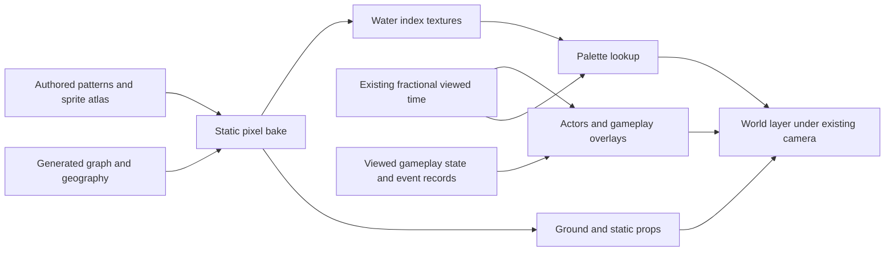

# Regional map: pixel rendering and timeline animation proposal

Status: proposed, 13 October 2026. The first static rendering review is implemented
in the isolated [Pixi workbench](../images/dark-fantasy/map-generation-prototype/README.md):
C preserves the approved base structure; F is the current Atlas rendering.
Earlier comparison modes are removed. The Atlas adds varied
engraved terrain silhouettes and an aged ochre/peat/slate fantasy-atlas palette
in response to the user's visual references. Its follow-up separates tall peaks
from rounded hills, strengthens biome and region readability, replaces sea
contours with depth shading, and renders a charcoal dead hinterland beneath a
separate switchable static fog layer. Future fog animation must sample absolute
viewed time independently of the ground bake, like water. The latest review
returns to parchment/olive/peat washes and composes overlapping, ink-hatched
massifs along winding mountain-region spines and the existing geographic range.
Compact groups fit narrow land; silhouette clearance retains coast, river and
valley gaps. Inked banks and coast-normal shore hachures replace the bright
coastal rim. Mountain ground and massifs now carry a subtle reddish umber tint.
These are rendering changes, not graph-generation changes. Art selection,
palette cycling and live-game generation integration remain pending.
See the [primary-source research](research/regional-map-pixel-rendering-research.md).

## Recommendation

Use a hybrid: generated geography determines shapes and material placement;
small authored pixel patterns and sprite families determine the visual language.
Bake static ground and water index patterns when a map changes. Animate water
through palette lookup sampled from the existing viewed-time clock. Keep actors,
gameplay information and selection above the ground.

This preserves the map's organic shapes without requiring hand-painted maps for
every seed or converting gameplay into a square tile board. Start in the existing
Pixi workbench, compare a small number of art treatments, then integrate the
chosen renderer. Pixi 7.2.4 can support this; an engine migration is unnecessary.

## Accepted geography and visual reference

The latest supplied screenshot is the reference for broad structures, rather
than a final terrain-art target:

| Setting | Reference |
| --- | --- |
| Seed | 1867 |
| Clustering | 15% |
| Size variation | 85% |
| Border variation | 100%, inferred from the full slider; numeric label is obscured |
| Features | River + Range |
| Surrounding ocean | South + west |
| Biome counts | Plains 2, Forest 4, Islands 3, Swamp 6, Mountains 5 |

[Reproduce the reference settings](https://im2skeptical.github.io/laughing-waffle-proto/images/dark-fantasy/map-generation-prototype/?seed=1867&clustering=0.15&size=0.85&roughness=1&features=0&variant=C).
The current generator reproduces the screenshot's counts and ocean sides at
these settings. These are an art-review fixture, not a change to defaults.

Retain unequal region areas, bounded shared-edge detail, region-scale bays and
headlands, connected island landmasses, adjacent ocean world sides, and blended
uninhabitable surroundings. Retain geographic interactions: inland river courses,
shoreline termination, widening mouths, mountain water gaps and valley corridors.
They are decorative geography, not a hydrology or elevation simulation.

Size variation must change the amount of visible terrain, not the size of its
texels or trees. Border variation must survive rasterization without turning
into one-pixel fuzz, seams or disappearing channels. Use one world-space texel
grid across neighbouring regions, with the same shared-edge ownership when
rasterizing their masks. Ground patterns should continue across same-biome
borders. Keep region identity and gameplay overlays separately readable.

## What already exists

| Concern | Current implementation | Proposed use |
| --- | --- | --- |
| Absolute looping phase and sprite frames | [timeline-presentation.js](../src/views/timeline-presentation.js): `loopPhase`, `sampleSpriteFrame` | Reuse for palette cycles and authored sprite clips |
| Finite event progress | Same module: `sampleEventProgress` | Reuse progress, then apply a pure easing function |
| Fractional presentation time | `resolveVisualTime`, called by [settlement-playback.js](../src/views/ui-root/settlement-playback.js) | Supply exactly this time to world effects |
| Existing consumers | [chronicle-effects-pixi.js](../src/views/chronicle-effects-pixi.js), [world-map-pixi.js](../src/views/world-map-pixi.js) | Landmarks, motes and transfer packets already sample viewed time |
| Eased motion | [world-map/packets.js](../src/views/world-map/packets.js) | Packet position already applies smoothstep to event progress |
| Terrain geometry | [chronicle-art.js](../src/views/chronicle-art.js): `addRegionTerrain` | Already tiles artwork in polygon masks with shared world alignment |
| Pan/zoom and interface easing | [world-map/camera.js](../src/views/world-map/camera.js), [transitions.js](../src/views/world-map/transitions.js) | Preserve the existing camera and its separate interface clock |

The contract in [visual-overhaul.md](../ai/visual-overhaul.md#time-first-rendering-contract)
already requires arbitrary seeks without replaying intervening visual frames.
Fractional time is accepted only within the displayed snapshot's integer second;
unavailable snapshots cannot be visually extrapolated. Existing tests include
nonsequential/reverse seeks and snapshot gating.

The active map uses illustrated tiling textures and masked sprites. The isolated
generation study uses vector fills/symbols and smooth background textures. There
is no palette-cycling shader in either. The current Atlas pixel study retains
explicit water indices alongside its resolved ground image. Nearest texture
sampling alone does not turn the original artwork into composed pixel art.

## Ground and prop treatment

The current direction is the illustrated fantasy Atlas, compared only with the
approved base geography. Broad parchment colour washes support authored woodland,
reed, hill, ruin and mountain families. Connected, overlapping massifs and
coast-normal hachures carry the relief. Earlier Quiet/Textured comparisons are
removed from the workbench and renderer.

The workbench now defaults to 5% clustering with 2.5-point controls. Its Detail
mode uses 2-unit ground texels and double-resolution engravings with finer
coastal strata, shore stones and feature marks, preserving symbol world size.
A bounded detailed bake overlays a cheaper distant backdrop so panning does
not require one oversized high-resolution texture.

The first hybrid illustration pass now consumes a generated transparent terrain
sheet through curated large/medium/small frames, with procedural sites, reeds,
roads, riverbanks and shore treatments. Roads receive land-checked corner
relaxation, gentle bends, textured verges and fixed river crossings. Shared
interaction treatments cover bridges, passes, existing gorges/estuaries, rocky
or soft coasts and woodland fringes. This is a prototype art-language trial;
asset coverage and intersection composition still need visual review.

The current prototype colours relief per texel from the underlying biome, with
softened foothill feet and upright, material-correct reflections. Plains hill
scatter stays inside plains. Sample roads connect reachable sites over dry
playable land, clear a decoration corridor, and use contrasting ink verges and
pale centres with planked river crossings. These routes remain presentation
fixtures; gameplay road ownership and connectivity are still a separate design.

Placement
and variation are deterministic from stable map/feature identifiers; density
depends on area and terrain. River corridors exclude peaks, coasts constrain
cliffs, and wetlands receive reeds and pools. Scatter forms clusters with clear
spaces rather than an even carpet of individual symbols. Keep towns and routes
readable among decorations.

The generation output owns geography. A visual raster records material,
shore/river distance and any effect-pattern data needed by the art. Transition
bands can mix discrete pixel clusters of adjacent materials instead of smooth
RGB gradients. Their widths use world units, not a fraction of each polygon.
The same materials extend into badlands, scrub, marsh and highlands outside the
playable area. Preserve the ocean-side rule and existing coastal interactions.

This graph/appearance separation has a useful precedent in Amit Patel's
[Mapgen2](https://www.redblobgames.com/maps/mapgen2/), which combines generated
geography and hand-drawn icons. Our recommendation is an application of that
separation, not a claim that its renderer is our desired pixel-art style. Do not
replace the approved biome quotas with a climate generator merely to render them.

## Palette-cycled water

Use a dedicated water/effects pass. Each water texel stores an index or phase
code; a small palette supplies its displayed colour. Changing cycle phase then
changes the lookup, while shoreline geometry and the large index texture remain
static. Begin with RGBA8 byte data for the current WebGL renderer; a compact
single-channel format is a later measured optimization.

Give ocean ripples, river flow, shoreline foam and magical effects distinct cycle
ranges or material banks. Paint/generate ordered spatial index patterns: shifting
a palette across arbitrary random pixels produces flicker rather than coherent
flow. River patterns follow distance along the directed course and across its
width; sea patterns can have longer, staggered wave bands. Water gaps and mouths
use the same land/water masks as their static artwork. No animated water appears
on dry land or continues into open sea as an independent river stroke.

Compare discrete index rotation with interpolation between neighbouring palette
colours. Both retain sharp spatial texels; the latter gives smoother temporal
motion but introduces intermediate colours. This is a visual choice, not a reason
to calculate more simulation ticks. Primary precedents and Pixi details are in
the [research note](research/regional-map-pixel-rendering-research.md).

Palette timing follows the existing sampler:

```js
phase = loopPhase(visualTimeSec, cycle.periodSec, cycle.offsetSec);
```

Each cycle has a stable offset and direction. Sample the phase anew for every
requested time; do not increment an offset per frame. Rewind naturally visits
the same colours in reverse order. Pausing freezes them, and a seek immediately
selects its correct phase. Keep world-effect rates in simulation seconds so the
playback transport controls their speed consistently.

For finite motion, compute event progress from its recorded start/duration and
apply a pure easing curve, such as `p * p * (3 - 2 * p)`. This gives acceleration
and deceleration without integrating motion. Loops need no simulation events;
gameplay-triggered effects need real event timing/endpoints. Do not interpolate
discrete ownership or resource changes into unsupported intermediate game states.
UI camera transitions can continue using wall time while world time is paused.

## Asset and renderer seam

Keep the renderer as a module behind a small interface: install terrain plus its
art revision, sample viewed time, and dispose resources. The existing map view
continues to own selection, input, panels and camera transforms. Internally:



Ground may be baked directly into pixels or rendered once into cached textures.
Encoded index data must be produced without antialiased blending that invents
indices. Use nearest sampling, disable index mipmaps, and sample palette entries
at texel centres. Test encoding/alpha handling through the actual Pixi path.
Avoid a full-screen filter for every region; begin with a shared water pass and
bounded cached terrain textures. Add chunk streaming only if measured world
extent, texture limits or memory require it.

Authoring can use indexed art, but uploading a normal paletted PNG through the
browser does not establish an indexed GPU texture. Export explicit index bytes
or a lossless encoded data image plus palette/cycle metadata. Keep that path
separate from [build-sprite-sheets.mjs](../scripts/build-sprite-sheets.mjs): its
PNG8 quantization/dithering and some atlas rescaling can change data values.
Ordinary static prop sprites can continue through the existing RGBA atlas loader.
Pixel assets need intentional source resolution and packing settings rather than
automatic reuse of the current landmark atlas's 40% scaling.

## Prototype steps and decision gates

1. **Static art study.** Keep the fixed 2424 x 1080 landscape Pixi window,
   Fullscreen, camera, selection, settings and geography. Show the two ground
   treatments with a small prop family. Compare two world texel densities at
   overview and close zoom on phone landscape. Keep UI text at normal resolution.
   Inspect small regions, river mouths, lagoons, narrow passages and full border
   variation. Choose an art treatment and texel density from actual images.
2. **Water study.** Add ocean, river and foam patterns plus a manually seekable
   fractional clock. Compare discrete/smooth cycling; test pause, repeated seeks,
   forward/reverse playback and cycle wraparound. Demonstrate directed flow and
   separate cycle banks. Changing time must never rerun map generation or terrain
   baking.
3. **Camera/performance study.** Compare free nearest-sampled zoom with discrete
   resting zoom/screen-pixel alignment. Noninteger scaling can shimmer; snapping
   may affect smooth gestures. Do not promise perfectly uniform physical pixels
   with arbitrary pinch zoom. Keep ground, props and effects on a consistent
   world grid, and overlays aligned with the effective camera transform. Measure
   frame time, texture memory, upload work, regeneration cost and scrub response
   on the Pixel 6 floor device, including simultaneous forecast work. Choose
   caching/resolution changes from those measurements.
4. **Game integration, after approval.** Reuse `getVisualTime` and existing
   timeline samplers. Replace terrain presentation behind the renderer seam;
   retain interaction and gameplay overlays. Adopting the prototype generator
   into authoritative game topology is a separate model decision, with its own
   determinism, serialization and replay review.

Prototype acceptance includes seed 1867, several other seeds, variation extremes
and both reflections. Same map/time must reproduce the same pattern and prop
placement regardless of visit order; camera movement must not consume RNG or
regenerate decorations. Masks must join without cracks, preserve visible river
courses and keep peaks out of water gaps. Review biome identity, gameplay contrast
and a static reduced-motion water treatment. A shader benchmark on desktop is
not evidence of phone performance: palette cycling avoids geometry/texture
rebuilds but still incurs fragment shading and fill cost.

## Impact and verification

The initial proposal changed documentation only. The Atlas static review now adds
prototype presentation code and authored pixel matrices, without integrating
into the live renderer. Live simulation state, RNG, schemas, replay and forecast
behavior are untouched. Verify documentation with `npm run check:docs` and
`git diff --check`; the static-review packaging also passes `npm run verify`.

For a later implementation, pure phase/event tests should cover repeat/reverse
seeks and wraparound; browser checks should compare frozen and revisited world
pixels on the same renderer and inspect WebGL errors, masks, fullscreen and
phone camera behavior. Game integration must also pass `npm run verify`, the
existing presentation tests and map/Chronicle probes. No extra simulation ticks,
sparse summaries or forecast-policy changes are needed for this renderer.

The coastal refinement defaults the prototype to Fine, reduces individual tree
scale into woodland canopy groups, and separates static shoals from foam, surf
and shallow-ripple index bands. These bands provide distinct animation masks;
actual palette cycling remains the next review step. Thinner road and river
strokes keep that additional coastline detail legible.
